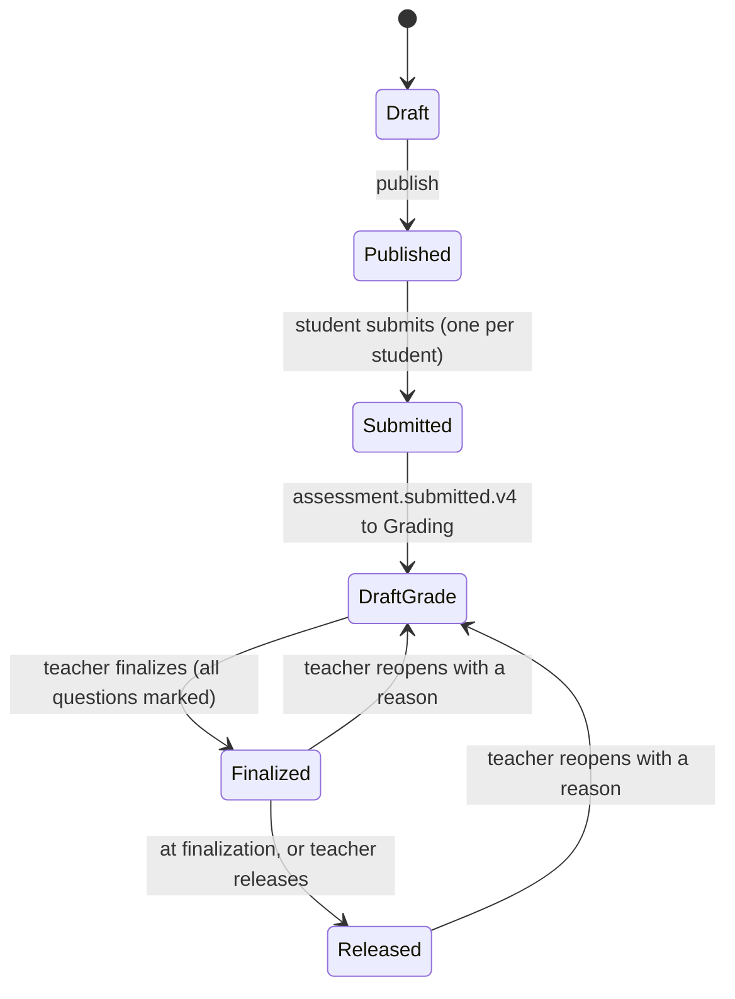

# How Learning Ledger is built

How the system is put together and how it runs, for someone reading the code. Why each rule exists is in
[decisions.md](decisions.md), cited here by number, for example "(decision 0020)". UI rules are in `DESIGN.md`
and `UX-CONTRACT.md` at the repository root.

## 1. Overview

Learning Ledger is a learning platform for schools.

- **Teachers** upload teaching materials, keep a curriculum of topics, write and publish assessments, mark and
  finalize grades, reuse questions from a question bank, build resits, and read each student's and each class's
  performance. AI can draft questions and marking guidance, suggest marks, and interpret results, always as
  drafts for the teacher.
- **Students** take assessments, see their own released results and progress, ask questions about their
  classroom's materials in a chat that cites its sources, and generate practice questions from chosen materials.
- **School admins** create their school's teacher and student accounts and classrooms, assign each classroom its
  teacher, enroll students, and watch platform health and their school's AI spend (decision 0019).

The backend is exactly ten business applications. That number is a rule: adding an eleventh needs a recorded
decision and the project owner's approval (decision 0001). Gateways, the identity provider, the broker, databases,
the web app and the monitoring collector are infrastructure, not business applications.

| Layer | Technology |
|---|---|
| Browser | Angular 21, strict TypeScript, signals, lazy-loaded sections |
| Go services | standard `net/http`, explicit SQL through pgx, `slog` JSON logs, shared `packages/platform` |
| Python services | FastAPI and Pydantic, Ruff, mypy, pytest, shared `packages/python-platform` (`learning_transport`) |
| Edge | Caddy 2.10: ends TLS for `app.localhost` and `auth.localhost` |
| Gateway | Kong 3.9 OSS, declarative config generated by `infra/kong/bootstrap.py` |
| Sign-in | Keycloak 26.3 in production mode, OIDC authorization code with PKCE, on its own PostgreSQL database |
| Events | Apache Kafka 4.1, one broker, three partitions per topic |
| Data | PostgreSQL 17 with pgvector, one database and role per data-owning service |
| Objects | SeaweedFS (S3-compatible), one `documents` bucket that only Content can use |
| Monitoring | a Go collector in `infra/monitoring`, shown to admins at `/admin/monitoring` (decision 0018) |
| Deployment | `docker-compose.yml`; every container has CPU and memory limits |

Shared packages hold only transport, auth, database, event and logging helpers; domain rules stay in their service.

## 2. The ten applications

| # | Application | Lang | Owns | Database | Main routes (behind Kong) |
|---|---|---|---|---|---|
| 1 | Identity and classrooms | Go | organizations, users, classrooms, enrollments; classroom access policy | `identity` | `/api/identity`: `/v1/me`, `/v1/classrooms`, `/v1/classrooms/{id}/access`, `/students`, `/student-ids`, `/v1/admin/accounts`, `/v1/admin/classrooms` |
| 2 | Curriculum | Go | topics (one level) and their prerequisites (decision 0007) | `curriculum` | `/api/curriculum`: `/v1/topics`, `/v1/topics/batch`, `/v1/topics/{id}/prerequisites`, `/restore` |
| 3 | Content | Go | documents, indexed chunks with embeddings, index and cleanup jobs, bucket objects | `content` + bucket | `/api/content`: `/v1/documents`, `/original`, `/reindex`, `/figures/{image}`, `/v1/search` |
| 4 | Assessment | Go | assessments with question snapshots and keys, submissions, saved answers, question bank, resit assignees | `assessment` | `/api/assessment`: `/v1/assessments`, `/publish`, `/submission`, `/saved-answers`, `/resits`, `/assignees`, `/v1/bank/questions` |
| 5 | Grading | Go | evaluations (draft and finalized grades), audit trail, AI marking jobs | `grading` | `/api/grading`: `/v1/evaluations`, `/marks`, `/finalize`, `/release`, `/reopen`, `/counts`, `/mine` |
| 6 | Analytics | Python | read model of released grades: per-topic evidence and metrics | `analytics` | `/api/analytics`: `/v1/performance`, `/v1/performance/{student_id}` |
| 7 | ai-core | Python | the only route to model providers; usage ledger and spend reservations | `aicore` | not routed by Kong; private `/v1/inference`, `/v1/ingest`, `/v1/rerank`, `/v1/usage` |
| 8 | Question generation agent | Python | nothing (stateless): question and guidance drafts, student practice | none | `/api/question-generation`: `/v1/questions`, `/v1/marking-guidance`, `/v1/practice` |
| 9 | Student performance agent | Python | nothing (stateless): interpretations and class insights | none | `/api/performance-agent`: `/v1/performance_interpretation`, `/v1/class_insights` |
| 10 | Question chatbot agent | Python | chat threads and messages with citations and checks | `chatbot` | `/api/chatbot`: `/v1/threads`, `/v1/threads/{id}/messages`, `/v1/usage` |

Every application also serves `/health/live` and `/health/ready` on its private port 8080, and private
`/internal/metrics` (Prometheus text) for verified service tokens with the `ai-client` role.

Each application lives in `services/<name>/` with its own Dockerfile, configuration, migrations
(`migrations/NNN_name.sql`) and tests. The browser app is `apps/web`, shared helpers are in `packages/`, API and
event contracts in `contracts/`, edge, gateway, realm migration and collector in `infra/`, and setup, checks,
stack tests and evals in `scripts/`.

## 3. Request path and security

Browser → Caddy edge → Kong → application → (Identity for access, ai-core for models). Sign-in goes browser →
edge → Keycloak.

### Edge and gateway

- The edge (`infra/edge/Caddyfile`) is the only public entry. It ends TLS with Caddy's local certificate
  authority. `app.localhost` serves the web app and, on the same origin, sends `/api/*` to Kong.
  `auth.localhost` goes to Keycloak.
- Kong (8000) and Keycloak (8081) are also published on 127.0.0.1 for scripts and tests only. The web container is
  not published.
- Kong routes `/api/<name>` to `http://<name>:8080/v1` and strips the prefix. Its global plugins:
  - `jwt`: checks the RS256 signature against Keycloak's realm public key, registered under the token issuer, and
    the `exp` claim;
  - `correlation-id`: adds or echoes `X-Correlation-ID`;
  - `rate-limiting`: 120 requests a minute per `Authorization` header, counted per Kong node;
  - `request-size-limiting`: 6 MB, except Content's route at 51 MB for 50 MiB uploads;
  - `cors`: only the web app's origin.
- Route timeouts: 20 s by default, 310 s for Content (uploads), 150 s read for the chatbot with response buffering
  off (server-sent events), and 300 s for question generation and the performance agent. Kong re-resolves service
  names every 5 s, so new replicas get traffic without a restart.

### Tokens and roles

- The browser signs in with OIDC authorization code and PKCE through Keycloak JS. Tokens stay in memory.
- Every backend verifies the token again itself: RS256 signature from the realm's JWKS, issuer, audience
  (`learning`), expiry, and the subject and organization claims. Kong passing a request confers nothing.
- No user identity header is trusted. The caller is whoever the verified token names.
- Human roles are `admin`, `teacher` and `student`. An account is exactly one of them and keeps the role it first
  registered with. A token with more than one is refused everywhere with 403 `ROLE_CONFLICT`.
- Service clients use OIDC client credentials. `content-indexer`, `grading-marker` and the three agents carry the
  `ai-client` role that ai-core requires; no ordinary user has it. `identity-accounts` lets Identity create and
  remove Keycloak users (`manage-users` only); `monitoring-reader` lets the collector read telemetry and spend.

### Resource membership

- Identity owns classroom access. Other services ask `GET /v1/classrooms/{id}/access` with the caller's own
  bearer token, and Identity verifies that token again.
- The answer names the caller's relation: `teacher` for the classroom's owner, `student` for an enrolled student.
  Teacher-only data (answer keys, rubrics, marking points, grade review, legacy rubric and marking-scheme
  documents) is gated on that relation, never on the token's `teacher` role alone.
- If Identity is unavailable, authorization fails closed. Authorization calls time out after 5 s.
- Admins work only through Identity's `/v1/admin/` routes, limited to their own organization. An admin has no
  classroom relation, so no service shows them classroom data. Another school's classroom answers 404.
- Agents read other services with the user's own token, so an agent never gets wider access than its user.

### Networks

| Network | Internal | Members |
|---|---|---|
| `edge` | no | edge, web, Kong, Keycloak |
| `app` | no | the ten applications, Kong, Keycloak, monitoring, gateway-config job |
| `data` | yes | PostgreSQL, Kafka, SeaweedFS, Keycloak, their init jobs, and the eight data-owning applications |
| `events` | yes | Kafka and the monitoring collector |

Only applications that own data join `data`. Question generation and the performance agent sit on `app` alone, so
they cannot reach a database or the broker. The collector reaches Kafka over `events` and has no route to
PostgreSQL. `data` and `events` have no route out.

## 4. Data and events

### Database per service

- Eight application databases (`identity`, `curriculum`, `content`, `assessment`, `grading`, `analytics`,
  `aicore`, `chatbot`) plus Keycloak's own. Each has its own non-superuser role, which owns only that database.
- No service reads another's database. Ids that cross services are plain references, not foreign keys.
  Assessment validates topic ids through Curriculum's API; Grading gets questions and marking points inside the
  submission event.
- Migrations are numbered SQL files applied in order at startup under a PostgreSQL advisory lock and recorded in
  `schema_migrations` (versions 1..n, no gaps). Changes go in a new file, never an edit to an applied one.
  Migrations are additive; destructive ones need the owner's explicit approval. Concurrent index builds run on
  their own session so they never hold a table lock.
- Advisory locks everywhere use one helper (`platform.Lock`, `learning_transport.db.lock`) with canonical
  lowercase uuid keys.

### Transactional outbox and consumers

- A producer writes its event to its own `outbox` table in the same transaction as the business change.
- A relay in every replica publishes due events in batches of up to 100, every second. Batches are locked with
  `FOR UPDATE SKIP LOCKED`, and only the oldest unpublished event per topic and key is due, so one resource's
  events stay in order.
- Failed deliveries retry with backoff (at most five minutes apart) for 300 attempts, about a day, then wait for an
  operator. Published events are pruned after 7 days.
- Consumers record each event id in an inbox in the same transaction as the effect, and commit the Kafka offset
  only after that transaction, or after a confirmed dead-letter write. A redelivered event is a no-op. Duplicate
  events are covered by integration and database tests.
- Transient errors are retried five times. Then the consumer stops without committing and restarts from the last
  committed offset with backoff (5 s doubling to a minute). Invalid messages go to `<topic>.dlq`. Python consumers
  also dead-letter events that hit a permanent database error, so they cannot block a partition.
- Kafka keeps topics 30 days by default and 7 days for submissions, finalized and reopened grades, and every
  dead-letter topic. Topic auto-creation is off; the `kafka-init` job creates them all.

### Topics

| Topic | Producer | Consumers and effect |
|---|---|---|
| `content.uploaded.v1`, `content.indexed.v1` | Content | none |
| `content.deleted.v1` | Content | chatbot blanks citations of the deleted document (`removed: true`) |
| `assessment.submitted.v4` | Assessment | Grading creates the draft grade |
| `assessment.due_changed.v1` | Assessment | Grading recomputes `late` |
| `assessment.deleted.v1` | Assessment | Grading and Analytics purge its grades and evidence |
| `grading.finalized.v3` | Grading, at release | Analytics adds or replaces evidence |
| `grading.reopened.v1` | Grading | Analytics marks the grade withdrawn |
| `identity.classroom.deleted.v1` | Identity | Content, Assessment, Grading, Analytics and chatbot purge the classroom |
| `identity.classroom.reassigned.v1` | Identity | Grading bills the classroom's AI marking to the new teacher |
| `identity.enrollment.removed.v1` | Identity | Grading stops AI marking of the removed student's work |
| `identity.enrollment.added.v1` | Identity | Grading re-queues that student's stopped suggestions |
| `identity.user.deleted.v1` | Identity | Assessment, Grading, Analytics and chatbot purge the user's work |

Consumed topics have a `.dlq` topic. `assessment.submitted.v4` carries answer-key snapshots, so it is confidential
and needs strict broker ACLs in production.

### Deletion and redaction

- **Classroom (admin):** Identity soft-deletes it, removes its enrollments and emits
  `identity.classroom.deleted.v1`. Each consumer purges its own rows in the consumer transaction and records the
  id in `purged_classrooms`, so a late event cannot bring data back. Content also refuses an upload still under
  way, and the chatbot a new thread. ai-core's usage ledger is kept for billing.
- **Assessment with submissions (teacher):** `DELETE` answers 409 `HAS_SUBMISSIONS`; with
  `?with_submissions=true` it deletes the assessment and its submissions and emits `assessment.deleted.v1`. Grading
  and Analytics purge and keep `deleted_assessments` (decision 0008).
- **Own account:** `DELETE /v1/me` soft-deletes the user, clears names, removes enrollments and emits
  `identity.user.deleted.v1`. A teacher who still owns a classroom gets 409 `OWNS_CLASSROOMS`; an admin gets 403
  `ADMIN_ACCOUNT`. Consumers purge the user's work and keep `deleted_users`. Identity then removes the Keycloak
  user, retrying each one with its own backoff (decision 0011).
- **Document (teacher):** Content deletes the row, chunks and index job and emits `content.deleted.v1` in one
  transaction, and queues an `object_cleanup_jobs` row. A leased worker removes the objects after commit. An hourly
  sweep removes bucket objects older than 6 hours that no row names (decisions 0010, 0012).
- **Removed student:** submissions and grades are kept and return on re-enrollment. Teacher lists and counts in
  Grading and Assessment follow Identity's current roster.
- **Known gap:** Assessment does not consume `content.deleted.v1`, so teacher-only passages and marking points
  copied from a deleted material stay in questions.

## 5. Core workflows

### Assessment lifecycle

1. **Draft.** A teacher writes up to 50 questions: multiple choice, numerical, short answer (accepted answers) and
   free response (rubric, optional model answer), each with points, a topic, and up to five teacher-only marking
   points. Drafts are replaced with `PUT` and can be deleted.
2. **Published.** `POST /publish`. Students see it only after `opens_at`. It stays fully editable until the first
   submission; after that only the title, due date and late policy change.
3. **Submitted.** Answers autosave. Each student submits once. After `due_at` a submission is flagged late or
   refused (409 `CLOSED`), as the late policy says. Answers to questions the teacher has since replaced get 409
   `ASSESSMENT_CHANGED`. Students never receive answer keys from Assessment.
4. **Draft grade.** Grading consumes `assessment.submitted.v4` and grades deterministically with exact decimal
   arithmetic. Short answers that match no accepted answer and free responses wait for the teacher
   (`needs_marking`), optionally with an AI suggestion (section 6).
5. **Finalized.** Only a teacher finalizes, one grade or every fully marked grade at once
   (`POST /v1/evaluations/finalize`). The evaluation row is locked and the record and audit entry are written
   together. Finalizing is refused while a question is unmarked, and a repeat gets 409.
6. **Released.** `grading.finalized.v3` is written to the outbox when the grade is released: at finalization, or
   at `POST /v1/evaluations/release` for a manual-release assessment. Students see only their own released
   results. Draft grades are visible only to the classroom's teacher.

### Reopening a grade

`POST /v1/evaluations/{id}/reopen` takes a reason of 1–1000 characters. The grade becomes a draft at its next
`revision`, with an audit entry, and the student stops seeing it. If it was released, Grading emits
`grading.reopened.v1` and Analytics marks the evidence withdrawn until the new revision is released (decision 0016).
Analytics keeps only the newest revision of each evaluation, so an old or repeated event changes nothing.

### Question bank and resits (decision 0017)

- Each teacher has one bank of up to 2,000 questions (409 `BANK_FULL`). A bank question is an assessment question
  without its id, passages or marking points. "Save to bank" copies a question from any of the teacher's
  assessments; `question_bank_links` records which assessment question came from which bank question.
- `POST /v1/assessments/{id}/resits` makes a draft from a published assessment: 1–100 students on the roster and
  1–50 questions from the original and the bank. A resit is visible only to its listed students.
  `PUT /v1/assessments/{id}/assignees` changes them; a student who submitted cannot be removed.
- The original grade is never changed. A second attempt is always a resit.

### Analytics

Analytics builds its read model only from released grades. Per topic it reports accuracy, attempted and correct
counts, part marks and an explicit insufficient-evidence status. "Needs practice" means under 60% of the marks on
the topic's latest ten questions, with at least five. It makes no mastery-probability claim.
`GET /v1/performance?classroom_id=` pages the current roster through Identity.

Curriculum topics are one level with prerequisites (cycle detection counts archived topics). Topics are archived,
never deleted, so old questions and evidence keep their names.

## 6. AI design

### Rules every AI path keeps

- ai-core is the only service that holds provider keys (OpenAI and Voyage) or calls a model. Provider failures are
  errors (502 `AI_PROVIDER_FAILED`, 503 `AI_PROVIDER_NOT_CONFIGURED`), never placeholder output.
- Every paid call names the user it is billed to (`billed_to`): the searching or chatting user, the teacher who
  uploaded a document, the assessment's teacher for marking, the teacher for generation and agents, and the student
  for practice (decision 0003).
- Daily allowance since local midnight (`SPEND_TIMEZONE`, default Asia/Singapore): **$5 for a student, $10 for a
  teacher**. Past it, ai-core answers 429 `AI_SPEND_LIMIT` before calling any provider.
- Before each provider attempt ai-core reserves an estimated maximum cost in `budget_reservations` under a
  per-user advisory lock, counting recorded spend and outstanding holds. Actual usage replaces the estimate in the
  `usage` ledger. Uncertain outcomes keep a conservative hold. A call that times out is charged as an estimate.
- At most 10 concurrent calls per user across replicas (`AI_USER_CONCURRENCY`), else 429 `AI_BUSY`. An optional
  `AI_TOTAL_SPEND_LIMIT_USD` adds a shared ceiling.
- Agents read business data only through service APIs with the user's token. AI output never changes a grade and
  never reaches a student as a grade. Claims are checked against the evidence they cite; unsupported ones are
  dropped and counted, never repaired.

### Model profiles (decision 0023)

| Profile | Model and reasoning | Used by |
|---|---|---|
| `default` | `CHAT_MODEL`, low reasoning for structured replies | writers: generation, marking, agents, chat answers (streams use no reasoning) |
| `check` | `CHECK_MODEL` (`gpt-6-luna`), medium reasoning | marking critic, question reviewer, chat support check |
| `fast` | no reasoning | chat query rewrite |

Embeddings use `text-embedding-3-small` (1536 dimensions); reranking uses Voyage `rerank-3`.

### Ingest and retrieval

- A teacher uploads a PDF (up to 50 MiB). Content commits the document (`indexing`) and an `index_jobs` row
  together. Two workers lease jobs with `FOR UPDATE SKIP LOCKED` and a 30-minute lease; after six failed attempts
  the document shows `AI_UNAVAILABLE`.
- ai-core `/v1/ingest` extracts text and layout locally (PyMuPDF), sends only uncertain figures and tables to a
  vision model, chunks (600 tokens, 90 overlap, slide boundaries kept) and embeds. Limits: 500 pages, 5000 chunks
  (`TOO_LARGE`). Content stores chunks with pgvector embeddings, a full-text index and figure crops, then emits
  `content.indexed.v1`. A reindex keeps the old chunks searchable until the new result replaces them.
- Markdown (5 MiB), PPTX and DOCX (50 MiB) are read locally into heading-aware chunks through the same queue and
  spend checks; citations show slides or section paths (decision 0013). Plain text is extraction-only.
- `POST /v1/search` checks classroom access through Identity, runs a vector leg and a keyword leg, fuses them with
  RRF and reranks through ai-core. If reranking fails it falls back to RRF order; if the query embedding fails, to
  keyword-only search. Students only ever get teaching material.
- Relevance floors on rerank scores: the chatbot needs a best passage above **0.61** (`RELEVANCE_FLOOR`), and drops
  sub-topic passages under **0.5** (`TOPIC_FLOOR`). Question generation drops passages under **0.5** and refuses
  with 422 `INSUFFICIENT_SOURCE` when nothing passes. Unscored (fallback) results cannot be checked against a
  floor, so the chatbot answers `SEARCH_UNAVAILABLE` and generation 503 `RERANK_UNAVAILABLE`.

### Question chatbot (decisions 0002, 0025)

One turn:

1. A short, single-subject first question ("what is…") skips the rewrite. Otherwise a `fast` rewrite produces a
   standalone query, detects small talk and off-topic questions, and splits several topics into up to three
   sub-queries.
2. Content search with the user's token: the primary query first, then each sub-query whose terms the primary hits
   did not cover.
3. Passages fill the prompt up to 12 passages, at most 5 from one document, within `CONTEXT_TOKENS` (8000). Each
   is marked with its primary topic, and multi-topic prompts group passages by that topic. If nothing passes the
   floor or fits, the turn refuses without an answer call.
4. ai-core streams the answer with citation tags, which the chatbot maps to chunks. A local check adds a coverage
   notice when a requested topic has no cited passage.
5. The `done` event closes the answer and the question box is free again. A support check on the `check` profile
   then runs: it adds "The cited passages may not support: …" for unsupported statements, or "This answer does not
   cite the materials." for an uncited factual answer, sent as a `notice` event and saved. "Partial" verdicts show
   nothing for now. A failed check shows nothing.

Every turn is saved, interrupted ones included, with its rewritten query, given and cited chunk ids, prompt
version, model, tokens, latency and check verdicts. A user has one answer in progress at a time
(409 `TURN_IN_PROGRESS`). Every thread read and turn re-checks classroom access.

### Question generation for teachers (decisions 0006, 0015, 0026)

- The agent reads the topic from Curriculum and passages from Content with the teacher's token, then makes a
  structured call billed to the teacher.
- Deterministic checks drop or return drafts: the quote must appear in the cited passages, the key must fit the
  options, no duplicates, no "according to the passage", and nothing that points at figures or lists.
- A reviewer on the `check` profile sees each draft and only its cited passages. It judges answerability, the key,
  whether the evidence supports the key, whether another option is also right, and repeats. Rejected drafts go
  back with the reason, up to two retries within a 240 s deadline, at most six model calls in all.
- Drafts with weak wrong options but a sound key are returned flagged, without a rewrite. A reviewer failure
  returns drafts marked not reviewed. Teachers can turn the review off per request.
- Marking guidance (accepted answers, rubric, marking points) gets one review and one rewrite, at most 4 calls,
  then 422 `GUIDANCE_REJECTED`.
- Nothing is stored. The teacher adds drafts to the editor, and Assessment validates them like any question.

### Student self-practice (decision 0022)

- `POST /v1/practice` for an enrolled student: 1–10 whole teaching materials, optional topic and focus, multiple
  choice and short answer only, billed to the student.
- The review always runs and fails closed. Only passed drafts are returned; flagged and unreviewed ones are dropped
  and counted. A set the reviewer never judged answers 503 `REVIEW_UNAVAILABLE`, and with the review switched off
  the route answers 503 `AI_UNAVAILABLE`.
- Keys, explanations and sources come back with the set; the Practice page reveals each only after the student
  checks that answer. This is the one exception to "students never see answer keys", for questions the student
  generated. Nothing is saved or graded.

### AI marking suggestions and the critic (decisions 0004, 0020, 0024)

- When an assessment turns suggestions on, each question waiting for the teacher gets a `marking_jobs` row. Leased
  workers make one structured call each, billed to the assessment's teacher, with the rubric and marking points.
  Exact matches of an accepted answer need no model call.
- Grading checks the reply (known levels, each criterion once, quotes that appear in the answer) and stores it on
  the draft as a suggestion only. A reply that gives marks while quoting words against them fails as
  `CONTRADICTED`.
- The critic then marks the same answer blind, on the `check` profile, without seeing the first suggestion. Code
  compares the two: different levels, low confidence or a new flag make it `doubtful`; otherwise `agreed`; a
  failed check is `not_reviewed`, never agreed. `MARKING_CRITIC=off` turns it off.
- The review page shows doubtful drafts first with a "Check AI mark" chip, and both finalize dialogs warn without
  blocking. `/counts` reports `ready_doubtful`.
- AI never changes a mark. The teacher marks every question, choosing "Use suggestion" or not, and grades stay
  drafts until the teacher finalizes them. Students never see suggestions.

### Performance interpretation and class insights (decisions 0014, 0021)

Both run in the student performance agent on one turn loop (`loop.py`): up to 5 structured turns, a 120 s deadline
for tool turns and a 240 s budget for the request, billed to the teacher. Each turn either calls up to three
read-only tools or reports; the last turn must report. The model cites short references (`R1`, `T1`, `Q1`, `S1`,
`E1`) instead of ids. Each response carries `requires_teacher_review`, its cited evidence, what the checks dropped
and the agent's steps. Nothing is stored.

- **Interpretation:** for one enrolled student, it opens with the released topic summary, the newest 20 finalized
  results, the questions and topic names. Tools: `read_answers`, `prerequisites`, `class_comparison`. Observations
  must cite questions it was shown; misconceptions must cite answers it read that lost marks. No finalized results
  gives 422 `NO_EVIDENCE` with no model call; nothing surviving the checks gives 422 `INTERPRETATION_REJECTED`.
- **Class insights:** a teacher's question (1–500 characters, up to three earlier questions as context). It opens
  with the class's released topic metrics (first 200 students in roster order), roster names and topic names.
  Tools: `topic_detail`, `topic_questions`, `student_results`, `read_answers`, `prerequisites`. The model sees
  students only as `S1` references; names are added after the checks for cited students. A struggling student
  needs enough released evidence and a weak result. Percentages must match shares the agent was shown. Empty
  results answer `NO_EVIDENCE`, `NOTHING_TO_ANSWER` or `INSIGHTS_REJECTED`.

## 7. Web app

- `apps/web` is a strict Angular 21 app served by nginx. It reads its gateway and Keycloak URLs from nginx's
  `/config.json` before starting.
- Sections are lazy-loaded and kept mounted after the user leaves them (`core/keep-alive.ts`), so a half-written
  form or a loaded list is still there on return. Views inside Assessments, the question bank and Grading review
  are chosen by the address.
- State uses Angular signals in root services: `Session` (profile and role), `ClassroomContext` (the current
  classroom, remembered per user in the browser) and `ai-usage` (the AI meter). Each part of a page loads through
  `shared/section.ts`, which holds its value, loading flag and error, and ignores stale responses. Lists use server
  pages through `shared/paged-section.ts`.
- API clients use types generated from `contracts/http` into `src/api/generated`. Chat streams arrive as
  server-sent events (`core/sse.ts`).

Role-gated routes (`app.routes.ts`):

| Role | Lands on | Sections |
|---|---|---|
| Teacher | `/dashboard` | Class dashboard (with "Ask about this class"); Teach: Assessments, Question bank, Teaching materials, Students, Curriculum; Review: Grading review, Learning performance; Assistant: Ask the materials; Setup: Classrooms |
| Student | `/home` | Home; My work: Assessments, My results, My progress; Learn: Teaching materials, Ask the materials, Practice |
| School admin | `/admin/classrooms` | Classrooms, Accounts, Monitoring, in a separate shell with no classroom or AI meter |
| All | | Profile (account deletion) |

Guards send each role to its own landing page; they are a convenience, and the backends enforce every rule.

`DESIGN.md` owns the visual system and `UX-CONTRACT.md` owns behaviour. Every UI change must keep:

- loading, empty and failure states for each part of a page, with Try again and no automatic retry of mutations;
- keyboard use: native controls, focus moved to the result of an action, confirm dialogs with Cancel focused;
- narrow screens: the sidebar becomes a drawer under 900px, and tables scroll sideways without page overflow;
- unsaved work: a dirty form locks the classroom choice and warns on unload;
- AI output labelled as AI-written, with its sources, changing nothing until the user acts.

## 8. Contracts and quality

### Contracts

- `contracts/http` holds one OpenAPI document per application plus one for the monitoring collector.
  `contracts/events` holds a JSON schema per event topic.
- `scripts/export_contracts.py` writes them from the code. `--check` fails when the committed files differ from
  what the code produces. The web app's `npm run contracts:check` keeps `src/api/generated` in step, and each Go
  service's `contract_test.go` checks that the structs it writes match its document's schemas.

### Local gate: `python scripts/check.py`

It runs 16 lanes in parallel (`--jobs`, `--keep-going`, `--timeout`):

| Lane | Steps |
|---|---|
| `apps/web` | format check, contracts check, ESLint, type check, Vitest unit tests, production build |
| Go modules (`packages/platform`, `infra/monitoring`, five services) | `gofmt -l`, `go vet`, golangci-lint, `go test`, `go build` |
| `packages/python-platform` | Ruff format, Ruff lint, pytest |
| Python services (five) | Ruff format, Ruff lint, mypy, pytest |
| `scripts` | Ruff on `scripts` and `infra`, pytest on `scripts/tests` |
| `contracts` | `export_contracts.py --check` |

Tests that need PostgreSQL skip here and are listed as not run.

### Real infrastructure: `python scripts/stack_tests.py [integration] [db] [e2e]`

- Builds a disposable Compose project, `learning-test`, beside the development stack: edge on 18443, Kong on
  18000, Keycloak on 18081, with its own volumes and generated realm and database init files. It runs the suites
  and removes the stack. `--keep` leaves it running, `--no-build` reuses images, `--live-ai` makes integration
  require real model answers (paid).
- `integration` (`scripts/integration.py`) drives the real gateway, Keycloak, PostgreSQL, S3 and Kafka:
  authorization failures, response and event schema validation, consumer restart, duplicate-event idempotency,
  purges and late events after purges, rate limiting, database isolation, monitoring and Kafka outage recovery.
- `db` (`scripts/db_tests.py`) runs the database-backed Go and Python tests, each in a scratch `<service>_test`
  database closed to other roles. It fails if a suite skips.
- `e2e` runs the Playwright browser suite. Its generation and chat specs stub model responses, so only integration
  checks real model answers.
- `scale` runs only when named (see section 9).
- Both integration and the browser tests refuse to run against the development stack unless told to.

### CI

`.github/workflows/quality.yml` runs on every push and pull request: Go lanes as a matrix, the Python lanes, the
contract check, the web lane, and an integration job that runs `scripts/stack_tests.py integration db e2e` on a
fresh stack (without live AI).

### Paid AI evals (`scripts/eval/`)

Run by hand against the local stack, through Kong, as local users. Each runner reads its cost from ai-core's
ledger and stops at a cost cap (`--max-usd`, default $0.50). Expected answers are the author's drafts with
`teacher_rating: null`; no teacher has rated them yet. Latest headline results:

| Eval | Runner | Latest result |
|---|---|---|
| Retrieval, 276 golden queries | `run_golden.py` | hit@1 0.951, MRR 0.974, recall@10 1.0, no leaks (2026-11-22) |
| Chat, 106 cases in 110 turns | `run_chat.py` | all 106 passed, the first clean run; time to `done` p50 3.2 s, max 7.1 s; support check on 110 statements: 84.5% supported, 13.6% partial, 1.8% unsupported (2026-11-22) |
| Chat support-check probe | `run_chat.py --probe-only` | every planted fault caught, no false alarm; changed numbers and names often grade partial, which shows no notice, so 69% of planted faults reach the student with a notice (2026-11-22) |
| Question reviewer probe | `run_generation.py --probe` | 39 of 39 planted faults caught (13 faults, three passes) with no good draft failed on `gpt-6-luna` at medium; low effort missed 1 and failed 8.3% of good drafts (2026-11-22) |
| Teacher generation, review on vs off | `run_generation.py` | 22 of 22 returned with the review; p50 16.8 s and 14 calls, against 8.8 s and 6 calls without it (2026-11-22) |
| Student practice | `run_generation.py --practice` | 18 of 20, then 20 of 20 returned, all passed review; median about 31 s (2026-11-22) |
| AI marking and critic, 53 harder cases | `run_marking.py` | level agreement 0.925; the critic doubted 3 of 6 first-marking errors (false-doubt rate 0.024); `gpt-6.2-sol` doubted 4 of 5 at about nine times the cost, so `gpt-6-luna` stays (2026-11-22) |
| Performance interpretation, 6 scripted students | `run_performance.py` | 10 of 10 accepted over two runs; precision, recall, misconception hits and expected tool use 1.0 (2026-10-27) |
| Class insights, 5- and 14-student classes | `run_class_insights.py` | 21 of 21 accepted over three runs per class; precision and recall 1.0, stability 1.0, prompt injection never obeyed (2026-11-21) |

These show the checks working on scripted cases, not accuracy on real classrooms.

## 9. Scaling and limits

### What scales horizontally

Any application can run as several replicas with no change beyond the replica count. Applications keep no session
or business state in memory (caches such as signing keys and query vectors are operational only). Kong spreads
requests across replicas. Every replica runs an outbox relay, and `SKIP LOCKED` batches with per-key ordering keep
events single and in order. Each service reads a topic as one consumer group, so partitions are shared. Index and
marking jobs are leased, so a dead replica's job is taken over. Migrations run under an advisory lock, SIGTERM
drains requests and workers, and ai-core's reservations and concurrency limit live in PostgreSQL.

`docker-compose.scale.yml` runs three replicas of Identity, Assessment and Grading, each capped at a quarter of a
CPU. `python scripts/stack_tests.py scale` creates 200 students and, with k6, has them all submit at a deadline
while reading steadily, at one replica, three replicas, and three with one Grading replica killed. It fails unless
every submission is accepted once and marked exactly once, the outbox drains and consumers have no lag. On a 4-CPU
machine (2026-10-19), one replica each fell behind the reads (p50 832 ms) and three kept up (p50 102 ms). A killed
replica cost one read of about 17,000. These numbers come from one machine and are not production capacity. The AI
paths are not load tested; provider rate limits and user allowances bound them.

### What is bounded

| Limit | Value |
|---|---|
| HTTP request time | 15 s, uploads 5 minutes (spooled to disk) |
| Uploads | PDF, PPTX, DOCX 50 MiB; Markdown 5 MiB; ingest 500 pages or 5000 chunks |
| Assessment | 50 questions; resit 1–100 students and 1–50 questions; bank 2,000 questions |
| Database pools | Go 10, Python 8 connections per replica by default |
| Python in-flight requests | 100 per replica |
| Kong rate limit | 120 requests a minute per access token, per Kong node |
| Pages | `/page` endpoints take `offset` and `limit` 1–100 |
| AI | $5 / $10 daily per student / teacher; 10 concurrent calls per user |

Shared single points in this setup: one PostgreSQL server for every database, one Kafka broker with replication
factor 1 and three partitions per topic (so at most three consumers per topic share work), and one edge, one Kong
and one Keycloak. A replica that dies without leaving its consumer group keeps its partitions until Kafka's session
timeout (30 s). Offset pagination can drift under concurrent inserts. Analytics reads all scoped evidence to
summarize it. Kafka retention (7 days for grades) is the only event archive. A resit can hold up to 101 shared
advisory locks, which counts against `max_locks_per_transaction`.

### Not production ready

Local Compose is a development deployment and is not claimed to be production ready. Production would still need:

- real certificates in place of the edge's local certificate authority;
- a sign-in realm without the password-grant `learning-e2e` test client and test accounts, with brute-force
  protection on and Keycloak's `/admin` kept off the public sign-in host;
- Kafka TLS, SASL and topic-scoped ACLs, with per-service broker credentials and per-service machine identities;
- backups and tested restores, including Keycloak's database, and signing-key rollover with overlapping keys;
- separate migration and runtime database roles, managed secrets, pinned image digests, and dependency, image
  and license audits;
- a staged upload saga instead of the hourly orphan sweep for S3 and SQL atomicity;
- a durable event archive or reconciliation API to rebuild Analytics beyond Kafka retention;
- tracing (no collector is installed) and an orchestrator with autoscaling;
- teacher-rated samples to settle open AI quality questions: the marking critic shares a model with the marker
  and repeats some of its errors, and "partial" chat verdicts show no notice.

Not built yet: numerical generated questions, practice targeted at weak topics, filling bank gaps with generation,
an adaptive resit agent, interpretations that run on finalization, saved interpretations or insight threads,
document revisions beyond the first, and cursor pagination. Static checks and focused browser tests are not a full
accessibility, multi-browser, load, chaos or security assessment.
