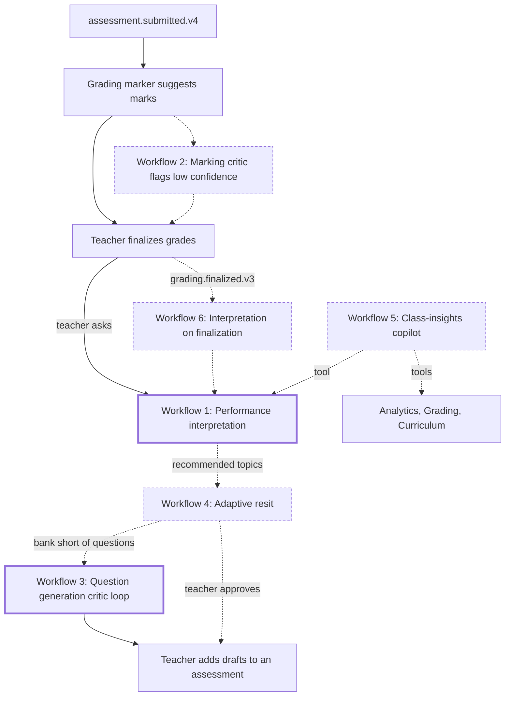
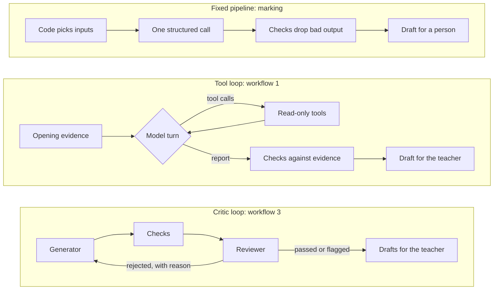
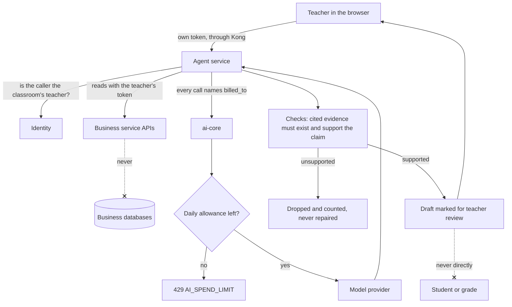
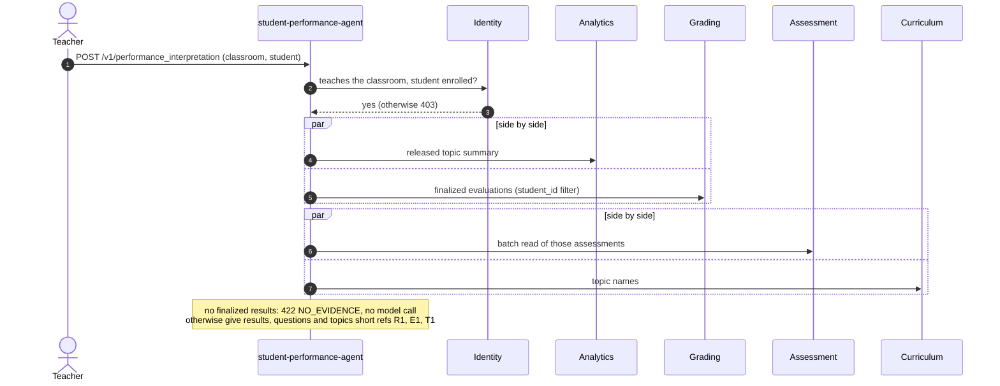
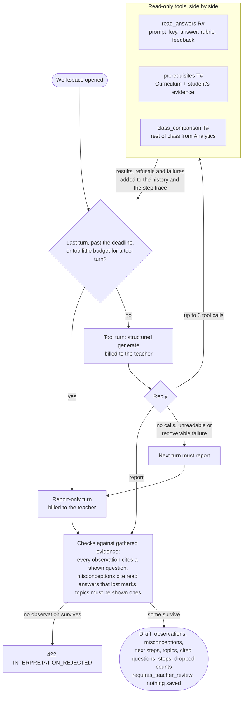
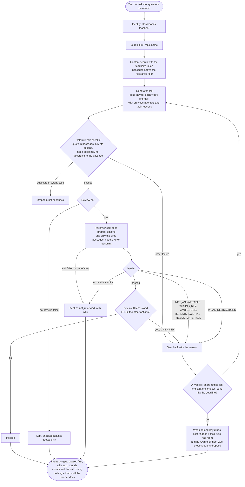

# Agentic workflows

The agentic features we could build, in the order we plan to take them, and where each stands. Retrieval (indexing, search, the chatbot's search and document formats) is worked on separately, so each entry says whether it touches that work. Update the status here when a workflow moves, and give each built one its own ADR.

| # | Workflow | Status | Touches retrieval |
|---|---|---|---|
| 1 | Performance interpretation agent | Built (ADR 0014) | No |
| 2 | Marking critic and escalation | Proposed | No |
| 3 | Question generation critic loop | Built (ADR 0015) | Reads the passages generation already has |
| 4 | Adaptive resit agent | Proposed, needs a question bank | Only if it generates new questions |
| 5 | Teacher class-insights copilot | Proposed | Yes, if it searches materials |
| 6 | Interpretation on finalization | Proposed, after 1 | No |

How the workflows would feed each other once built (thick border: built, dashed: proposed):

## What makes these agentic

Every earlier AI feature is a fixed pipeline: code chooses the inputs and makes one structured model call. In these workflows the model chooses what to look at next (tools), a later step checks or revises an earlier one (critics), or one agent's output starts another's work (hand-offs). Each one keeps the project's rules: every model call goes through ai-core and is billed to a person, tools read with the user's own token, nothing reaches a student or changes a grade without the teacher, and every claim is checked against the evidence it cites.

ADR 0014 built the pattern the others reuse, inside `student-performance-agent`: a turn loop over ai-core's structured `generate` (no tool-calling API was needed), short references the model cites instead of ids, a turn limit and a deadline that force a report, a step trace for the teacher, and checks that drop anything the gathered evidence does not support. If a second agent needs it, move the loop into `learning_transport` then, not before.

A fixed pipeline next to the two agentic shapes built so far:

The rules every workflow keeps, wherever its loop sits:

## 1. Performance interpretation agent

Built. A teacher asks for an interpretation of one student's finalized results. The agent starts from the topic summary and results, then chooses to read the answers behind weak topics, check prerequisites, or compare with the class, and drafts observations, possible misconceptions, next steps and topics to practise. Services: student-performance-agent, Analytics, Grading (new `student_id` filter), Assessment, Curriculum, ai-core. See ADR 0014.

Opening the workspace, before any model call:

The turn loop (defaults: five turns, a two-minute deadline for tool turns, a four-minute budget for the whole request):

`scripts/eval/run_performance.py` checks it against scripted students of known shape (`docs/development/operations.md`, Agent evals). Next steps for it: rate those reports by hand, try it on a few real students, then decide whether to link findings to teaching material once retrieval settles.

## 2. Marking critic and escalation

After `services/grading/marker.go` suggests a mark for a written answer, a second model pass checks it against the rubric and marking points and gives a confidence. Low-confidence suggestions, and similar answers in the same assessment that got different suggested marks, are flagged for the teacher first in Grading review. Services: Grading, ai-core, web review page. Effort: small to medium. A good demo because it can be measured against the marks teachers finalized.

## 3. Question generation critic loop

Built. A reviewer model pass checks each generated question against its cited passages only: answerable, key matches what the reviewer worked out, one right answer, plausible wrong options, not a repeat. Rejected drafts go back to the generator with the reason, up to two retries inside one deadline; weak wrong options are flagged for the teacher instead of dropped, and a reviewer failure returns drafts marked not reviewed. Teachers can skip the review per request. Services: question-generation-agent, ai-core, web generator panel. See ADR 0015.

One request, from passages to drafts (defaults: two retries, a 240-second deadline, so at most three writes and three reviews):

`scripts/eval/run_generation.py` compares requests with the review on and off, and its `--probe` sends planted faulty drafts straight to the reviewer to measure what it catches. Next steps for it: use the probe's misses to tune the reviewer, and decide from the on/off comparison whether the review earns its extra calls.

## 4. Adaptive resit agent

Takes the topics the interpretation agent recommends, picks questions on them from a question bank (or asks the generator for new ones), and drafts a personal resit for the teacher to approve and publish. Services: Assessment (question bank and resits, not built yet), student-performance-agent, question-generation-agent. Effort: large. It closes the loop from assessing to diagnosing to practice.

## 5. Teacher class-insights copilot

A chat for teachers ("who is struggling with recursion, and what should I reteach?") that answers with tools over Analytics, Grading, Curriculum and the interpretation agent, citing students and questions. Searching teaching material would go through Content's search, so agree that part with the retrieval work first. Effort: medium to large.

## 6. Interpretation on finalization

Run workflow 1 automatically when `grading.finalized.v3` arrives for a student whose evidence changed enough, store the draft, and show the newest one on the class dashboard. Needs storage for interpretations, a decision on who pays for runs nobody asked for, and a limit on how often one student is re-read. Services: student-performance-agent (consumer and database), Kafka, web. Effort: medium.
