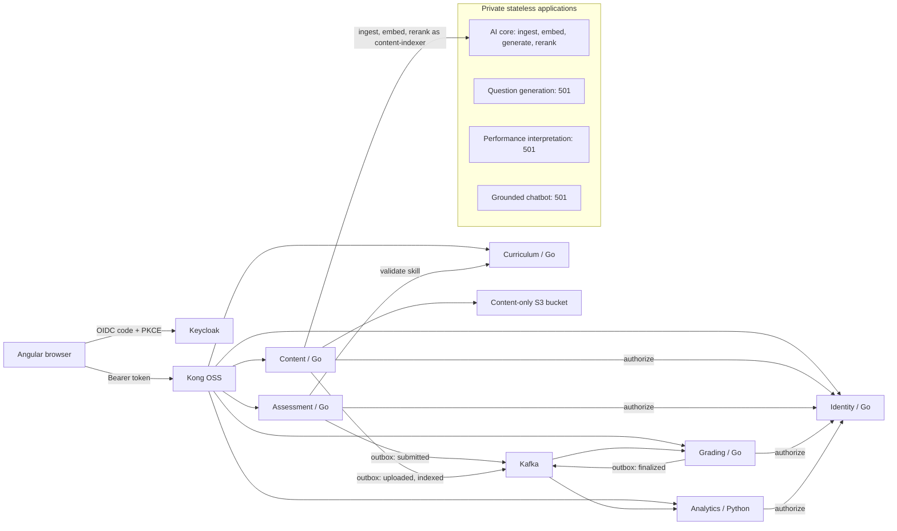
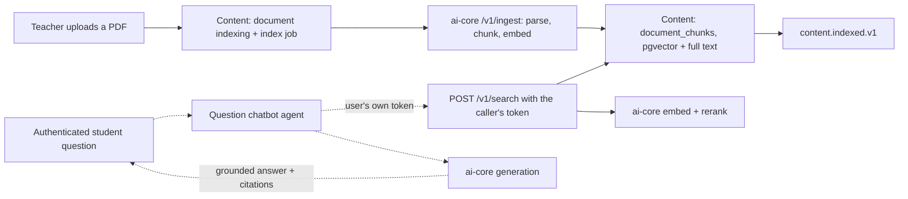

# Architecture actually implemented

Content is the only business service that calls an AI application: its indexing worker sends PDFs to ai-core, and search asks ai-core for the query vector and the rerank (ADR 0002). ai-core calls nothing back, so there is no circular dependency. Each persistent application connects only to its own database. Database and schema grants enforce the boundary; identifiers across services are references, not cross-database foreign keys. Assessment validates skill references through Curriculum. Identity is the policy owner for classroom access; bearer tokens forwarded by a business service are revalidated at Identity. No user identity headers are trusted.

Go domain files implement exact grading, assessment validation and text chunking without framework/database dependencies, except the small transport UUID helper used by assessment validation (a remaining layering cleanup). SQL is explicit, application transactions are visible in handlers, and source remains intentionally small. The shared Go package implements transport, auth, connection lifecycle, outbox plumbing and consumer inboxes; it owns no educational entity. Python's shared package implements auth/error/logging only.

## Data owners

Identity owns `organizations`, `users`, `classrooms`, `enrollments`. Curriculum owns `nodes`, `prerequisites`. Content owns `documents` including extracted text chunks and SHA-256/source revision metadata, `document_chunks` (indexed PDF chunks with pgvector embeddings and a full-text index), `index_jobs`, plus bucket objects (originals and figure crops). Assessment owns `assessments` with question snapshots and answer keys, and `submissions`. Grading owns `evaluations`, `audit`. Analytics owns its `evaluations`, `evidence` and `inbox` read model. Outbox/inbox tables are independently created in the application owner's database, not a shared event database.

The first migration is non-destructive and idempotent. Go migrations are embedded from each service's `migrations/NNN_name.sql` files and applied in order under a PostgreSQL advisory transaction lock; each version runs once and is recorded in `schema_migrations` (versions must run 1..n without gaps, or startup fails). Schema changes go in a new numbered file, never an edit to an applied one; `CREATE TABLE IF NOT EXISTS` is not an upgrade mechanism. Production migrations should run with separate owner credentials; local app roles own only their own database.

## Security and state

Kong verifies RS256 and expiration using the provisioned issuer/public key. Backends also verify issuer/audience/expiration, organization and application role. Classroom teachers can act only on their own classrooms. Students require enrollment and can query only their own evidence. Students never receive answer keys from Assessment's public projection. The broker's assessment topic contains confidential answer-key snapshots and must receive strict production ACLs.

Assessments are published immediately and immutable. Submission is unique by assessment/student. Grading drafts are unique by submission, remain invisible to analytics until a teacher commits finalization, and store reason plus before/after evidence in an audit table. Finalization locks the evaluation row and atomically writes the updated record, audit and outbox event. Retrying finalization receives 409. Analytics separately deduplicates event IDs and evaluation IDs so a new event ID for the same finalized grade cannot add evidence twice.

## AI and retrieval

Dashed steps are future work (ADR 0002 stage 4: the chatbot). ai-core implements `/v1/ingest` (PDF bytes in; chunks, vectors and figure crops out), `/v1/inference` (embed, generate, structured or streamed generation) and `/v1/rerank`, statelessly: Content stores the results. Provider failures are errors (502/503), never placeholder output; Content retries indexing and answers search with 503 `SEARCH_UNAVAILABLE` instead of inventing results.

Content's index: a PDF upload commits the document (status `indexing`) and its `index_jobs` row together. Worker goroutines lease due jobs with `FOR UPDATE SKIP LOCKED`; the result is stored in one transaction that first deletes the job by its lease, so a run that lost its lease (outlived it, or was taken over) changes nothing and `content.indexed.v1` is emitted once per completed run. Chunks carry copies of the document's org, classroom and type, kept identical by a composite foreign key, so search filters on them without a join; vectors are compared only within the query's embedding model. A reindex keeps the old chunks searchable until the new result replaces them. Search applies the caller's own classroom access (through Identity) and, for students, teaching material only; the chatbot will call it with the student's token, so an agent never gets wider access than its user.

The other three private Python applications define versioned input/output contracts and return `AI_CAPABILITY_NOT_IMPLEMENTED` (501) after authentication, role checking and validation. None accesses business data or uses test doubles in runtime code. The agent contracts carry untrusted references; accepting a syntactically valid reference is not authorization to retrieve it.
